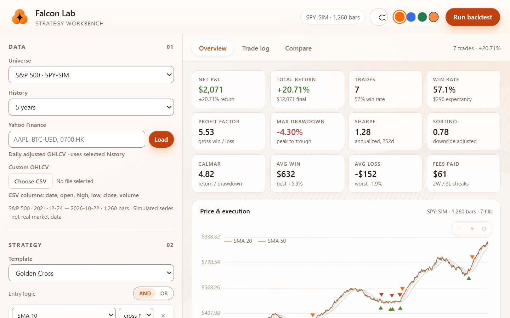

# Trading Strategy Backtester

[](https://github.com/nicholaschung1025-dot/trading-strategy-backtester/actions/workflows/ci.yml)
[](LICENSE)

**Falcon Lab** — a zero-dependency trading-strategy backtester. One
Python file serves it, no build step, no npm install, and the whole
interface is driven by a single set of design tokens.



---

## 1. Start it

```bash
python server.py
```

Then open <http://127.0.0.1:8765/index.html>.

* Nothing to install — the server only uses the Python standard library.
* `index.html` also opens straight from disk, but then the Yahoo Finance
  lookup has no proxy to talk to, so only the simulated universes and
  local CSV files work.

| Platform | Command | Notes |
| --- | --- | --- |
| Windows, one click | `start.bat` | Starts the server minimised and opens the browser |
| macOS / Linux | `./start.sh` | Same, opens the browser |
| Windows, at every log on | `powershell -ExecutionPolicy Bypass -File scripts\install-autostart.ps1` | Creates a scheduled task; remove it with `-Uninstall` |
| Any host with Docker | `docker compose up -d` | `restart: unless-stopped`, so it returns after a reboot |
| Linux VPS (systemd) | `sudo cp deploy/falcon-lab.service /etc/systemd/system/ && sudo systemctl enable --now falcon-lab` | Runs as a service on `PORT=8765` |
| VS Code | `Terminal → Run Task… → "Serve Falcon Lab"` | Background task, F5 friendly |

The server reads `PORT` from the environment (default `8765`) and binds
`0.0.0.0` whenever `PORT` is set, so it works unchanged behind Docker,
systemd or a hosted platform.

## 2. Use it

The screen has three parts: **Data** and **Strategy** on the left rail,
the results on the right.

**① Choose the data**

| Where | What you get | How |
| --- | --- | --- |
| Universe | A deterministic *simulated* series (tickers end in `-SIM`, e.g. `SPY-SIM`) | Pick one in **Data → Universe**, then set the history length |
| Yahoo Finance | Real adjusted daily bars | Type a ticker (`AAPL`, `BTC-USD`, `^GSPC`, `0700.HK`) in **Data → Yahoo Finance** and press **Load** |
| Custom CSV | Your own OHLCV file | **Data → Custom OHLCV → Choose CSV** — the file is parsed in your browser and never uploaded |

**② Describe the strategy**

* **Template** — six ready-made strategies (Golden Cross, RSI Reversion,
  MACD Momentum, Bollinger Squeeze, Dual Timeframe, Trend + Oscillator).
  Pick one and edit from there.
* **Rules** — add entry and exit conditions with `+ Entry rule` /
  `+ Exit rule`. Each condition is *indicator · operator · value or
  indicator*, and the row under the rule switches the right-hand side
  between a number and another indicator. Combine the rows with **AND** or
  **OR**.
* **Risk** — capital, stop loss %, take profit %, commission %, slippage %,
  the weekly trend filter and whether fractional shares are allowed.

**③ Run it**

Press **Run backtest** (or change anything — the app re-runs itself).
The status line on the right shows the trade count and the total return.

**④ Read the result**

* **Metric tiles** — net P&L, total return, trades, win rate, profit
  factor, max drawdown, Sharpe, Sortino, Calmar, average win/loss, fees.
* **Price & execution** — price with the SMA overlays, green triangles for
  entries and orange/red triangles for exits. Hover a marker for the
  trade details.
* **Equity curve** — strategy against buy & hold.
* **Drawdown** — the underwater curve.
* **Monthly returns** — one heat map cell per month, green or red.
* **Show data table** — every chart carries a table of exactly what is on
  screen, so the numbers are reachable without a mouse.
* **Trade log** — every closed trade with entry, exit, size, P&L, return,
  holding time and the reason it closed.

**⑤ Compare** — the *Compare* tab runs the same rules against a second
universe and puts the two equity curves side by side.

**⑥ Export** — **Download trades CSV** for a spreadsheet, or
**Download report TXT** for the full write-up (see
[`docs/DATA_FORMATS.md`](docs/DATA_FORMATS.md)).

### Shortcuts

| Action | How |
| --- | --- |
| Zoom a chart | Mouse wheel, or the `−` / `+` buttons, or `+` / `-` when the chart has focus |
| Pan a chart | Drag with the mouse, or the `←` / `→` arrow keys |
| Reset a chart | The `↺` button, double click, or `0` / `Home` |
| Trade details | Hover a triangle on the price chart |
| Change theme | The colour dots in the header (saved in the browser) |
| Pause the background | The wave button in the header |

## 3. Where the data comes from

* **Simulated universes** (default) — generated by the app itself from a
  fixed seed, so the same date range always produces the same series.
  They are labelled `-SIM` on purpose: they are *not* real prices.
* **Yahoo Finance** — real adjusted daily history, fetched through the
  local proxy in `server.py` (the browser cannot call Yahoo directly
  because of CORS).
* **Custom CSV** — `date, open, high, low, close, volume`; at least 60
  rows; parsed locally.

## 4. Deploy it (optional)

### GitHub Pages

1. Push to GitHub with the default branch `main`.
2. **Settings → Pages → Build and deployment → Source: GitHub Actions**.
3. The `Deploy to GitHub Pages` workflow publishes the site.

GitHub Pages cannot execute Python — it runs static assets plus *Pages
Functions* (JavaScript). The proxy for a Pages site is therefore
`functions/api/yahoo.js`, which does the same job as `server.py`. Pages
Functions are only mounted when the site source is set to **GitHub
Actions**; the REST API cannot toggle that, so it is the one manual step.
Until it is set, the app says so instead of failing silently.

### Any Python host (Render, Railway, Fly, Heroku…)

`render.yaml` is included, so Render can deploy with the Infra button. On
other platforms the start command is `python server.py` (see
`Procfile`).

```bash
render blueprint launch
```

A hosted `server.py` starts on its own and sends
`Access-Control-Allow-Origin: *`, so a static front end on another host
can use it: open the site with `?api=https://your-app.onrender.com`, or
paste the base URL into the **Deployment** panel in the left rail. Both
remember the choice in `localStorage`.

## 5. Data & privacy

**What the app sends, and where**

| Data | Where it goes | Notes |
| --- | --- | --- |
| Your uploaded CSV | **Nowhere** | Read with `FileReader` in the browser, parsed locally, never uploaded. There is no upload endpoint. |
| A ticker you type | The Yahoo proxy you configured | Only the symbol and the period. The proxy forwards it to `query1.finance.yahoo.com` and returns price history. |
| Your theme, background-animation and proxy preferences | Your browser's `localStorage` | Three keys only: `falcon-theme`, `falcon-bg-anim`, `falcon-api-base`. Nothing else is stored, and the proxy one can be cleared from the Deployment panel. |

**What the app never does**

* No analytics, no telemetry, no beacons, no error reporting, no cookies.
* No user accounts, no sessions, no server-side storage of anything.
* No request to any host other than the proxy you configured (enforced by
  `tests/privacy.test.mjs`).

**Server-side hygiene** (`server.py`)

* Access logs contain the path only — the query string, and therefore the
  tickers people look up, is never written to the log.
* The rate limiter keeps a truncated SHA-256 hash of the client address
  instead of the address itself, and forgets it after the window.
* Responses carry `Content-Security-Policy`, `Referrer-Policy:
  no-referrer`, `X-Content-Type-Options`, `X-Frame-Options` and
  `Permissions-Policy`. The CSP allows scripts only from the same
  origin, so no third-party code can be injected.
* The Pages Function caches nothing (`no-store`) and logs nothing.

**Two things worth knowing**

* Yahoo Finance data is for personal use; check their terms before
  redistributing it commercially.
* Git commits in this repository carry your e-mail address in the author
  field. If you would rather keep it private, enable *Settings → Emails
  → Keep my email address private* and rewrite the history with
  `git filter-repo --email-callback 'git commit --email=%an <%anon@users.noreply.github.com>'`.

Run `npm test` to verify all of the above — the privacy suite fails the
build if any of these invariants is broken.

## 6. Layout

```
index.html        markup only (no inline CSS or JS)
styles.css        design tokens + every theme
threads.css       background animation container
src/util.js       DOM + formatting helpers
src/indicators.js SMA, EMA, RSI, MACD, Bollinger, ATR, Stoch, ADX, VWAP, OBV…
src/state.js      the single shared state object
src/engine.js     dataset generation, CSV/Yahoo parsing, rule DSL, backtest engine
src/charts.js     canvas rendering, zoom/pan, accessible data tables
src/app.js        UI wiring, themes, exports
src/boot.js       applies the saved theme before the first paint
src/threads.js    WebGL background animation
functions/        GitHub Pages Function for the Yahoo proxy
legacy/streamlit/ the original Python/Streamlit app, kept for reference
tests/            node:test suites (engine golden values, WCAG contrast, privacy)
scripts/          lint + Windows auto-start installer
deploy/           systemd unit
start.bat         Windows: start the server and open the browser
start.sh          macOS / Linux: same
Dockerfile        container image
server.py         static server + Yahoo Finance proxy
```

## 7. Develop

```bash
npm run lint      # syntax + hygiene checks
npm test          # engine golden tests, colour contrast tests, privacy tests
npm run check     # both
```

* `tests/engine.test.mjs` pins the backtest results of every universe, so
  a change in the engine has to be a deliberate one.
* `tests/contrast.test.mjs` fails the build if any colour pair drops
  below WCAG AA.
* `tests/privacy.test.mjs` fails the build if analytics, cookies, extra
  storage keys, CSV uploads, query-string logging or unescaped values
  come back.

## 8. The original Streamlit app

The repository started life as a Python/Streamlit backtester. It still
lives in [`legacy/streamlit/`](legacy/) as a reference implementation of
the same engine — the web workbench is a port of it, not a rewrite from
scratch. Nothing in the root project imports from that folder.

## License

MIT — see [LICENSE](LICENSE).
